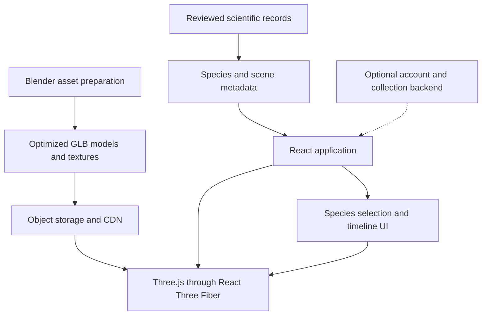

# 3D technology stack

Research date: **2026-11-16**.

## Requirement correction

The initial research assumed a mostly static educational atlas. The user clarified: **"This is a 3D app, not just a website with text."**

That supersedes the original Astro-first recommendation for the main experience. The scientific-source, provenance, licensing, and optional backend findings remain relevant. See [content-first alternatives](content-first-alternatives.md) for the earlier research and its limits.

## Recommended default

| Layer | Recommendation | Role and qualification |
|---|---|---|
| Application | React + TypeScript + Vite | Proposed client application and development/build setup |
| Rendering | Three.js through React Three Fiber | React-based composition of interactive 3D scenes |
| Helpers | Drei | Reusable controls and scene utilities; select only what is needed |
| Asset authoring | Blender | Proposed modeling, rigging, animation, and optimization workflow |
| Asset delivery format | glTF/GLB | Proposed format for exported models and animations |
| Shared UI state | Zustand, if needed | Proposed coordination of selections, filters, and time controls; not a requirement for every scene |
| Asset hosting | Object storage + CDN | Proposed delivery of models, textures, and audio; provider not selected |
| Backend | None initially unless product features require one | Supabase/PostgreSQL is an option for accounts, saved collections, and managed records |

React Three Fiber is a React renderer for Three.js. Its component model supports interactive scene objects that participate in the React ecosystem. Its official introduction warns that React and Fiber major versions must be paired correctly; verify compatibility when choosing dependencies.[^fiber]

No versions have been pinned and no package manifest has been created. Blender export settings, Drei helpers, state-management needs, asset-provider pricing, and the complete dependency combination have not been tested for this project.

## Why this default

For an educational 3D application, a React interface can coordinate an organism selection, information panel, camera view, and geological-period control while Fiber renders the scene. This is an architectural recommendation based on Fiber's documented model, not evidence that the planned application already exists.[^fiber]

Next.js is optional. Its server and client features may be valuable if later requirements include an integrated server application, but it does not replace the 3D renderer. Vite is the proposed simpler starting point for the client experience; no comparative benchmark was performed.[^next]

Astro may still serve a separate editorial or marketing area. It is not the recommended foundation for the main continuously interactive experience under the clarified requirement.

## When Babylon.js is the better choice

Prefer evaluating **Babylon.js** first if the core experience becomes a walkable prehistoric environment with character movement, collisions, physics, and game-like interaction.

Babylon documents a scene graph, animation and audio systems, collisions, physics integration, character controllers, WebXR, and WebGL/WebGPU support.[^babylon] Those integrated capabilities make it a credible alternative to assembling separate libraries.

This is not a claim that Three.js cannot support those features. Engine choice should follow a small representative prototype and team familiarity, not a universal ranking.

## Proposed architecture

This is a proposed architecture, not an implemented deployment. The optional backend must not hold or expose privileged credentials in the browser.

## Asset and scientific presentation pipeline

Proposed workflow:

1. Select an organism and gather scientific references.
2. Obtain or create an asset with documented rights.
3. Distinguish a scanned fossil from a reconstructed living organism.
4. Prepare geometry, materials, rigging, and animation in Blender.
5. Export a glTF/GLB asset and review its scale, orientation, and animation behavior.
6. Optimize, publish through the selected delivery service, and associate it with provenance metadata.
7. Evaluate loading, memory use, visual quality, and interaction on representative devices.

These are implementation recommendations; no models have been acquired, exported, optimized, or approved. Scientific and asset metadata requirements are documented in [scientific data and licensing](scientific-data-and-licensing.md).

## Performance priorities

The main concerns for the proposed 3D experience are asset download size, texture memory, draw calls, rendering effects, and animation cost. Proposed mitigations include optimized geometry, compressed textures, level of detail, reuse of materials, and instancing repeated vegetation.

Fiber's performance guide documents resource reuse, caching, instancing, and on-demand rendering.[^performance] On-demand rendering is appropriate for stationary exhibits that can become idle; continuously moving animals or habitats still need frames while animation is active.

Do not treat a documented illustrative draw-call number as a universal device budget. Determine project-specific budgets from a representative scene and target hardware. No frame-rate, memory, or download-size targets have been validated.

The official Fiber introduction observed during research described its WebGPU-capable v10 as alpha. Do not infer production readiness from a future-facing feature description; check the chosen stable release and browser requirements before committing.[^fiber]

## Open decisions

- Inspectable exhibits, a walkable world, or both?
- Desktop only, mobile support, or optional XR?
- Stylized or photorealistic art direction?
- Static poses, skeletal animation, or ecosystem simulation?
- Recently extinct organisms, prehistoric life, or both?
- Required scientific review process and acceptable reconstruction uncertainty?
- Number of simultaneous visible organisms and habitat complexity?
- Need for accounts, saved collections, or browser-based editing?
- Asset rights, creation capacity, and operating budget?

These are unresolved product decisions, not blockers to documenting the research.

## Confidence and limitations

High confidence in Fiber's documented relationship to React/Three.js and Babylon's published capabilities. Moderate confidence in the recommended stack until the interaction model and target devices are defined. No application prototype, comparative engine benchmark, asset audit, or deployment validation has been performed.

[^fiber]: [React Three Fiber introduction](https://r3f.docs.pmnd.rs/getting-started/introduction), retrieved during research.
[^performance]: [React Three Fiber performance guide](https://r3f.docs.pmnd.rs/advanced/scaling-performance), retrieved during research.
[^babylon]: [Babylon.js engine specifications](https://www.babylonjs.com/specifications/), retrieved during research.
[^next]: [Next.js Server and Client Components](https://nextjs.org/docs/app/getting-started/server-and-client-components).
